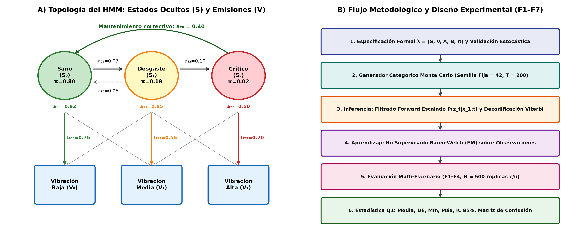
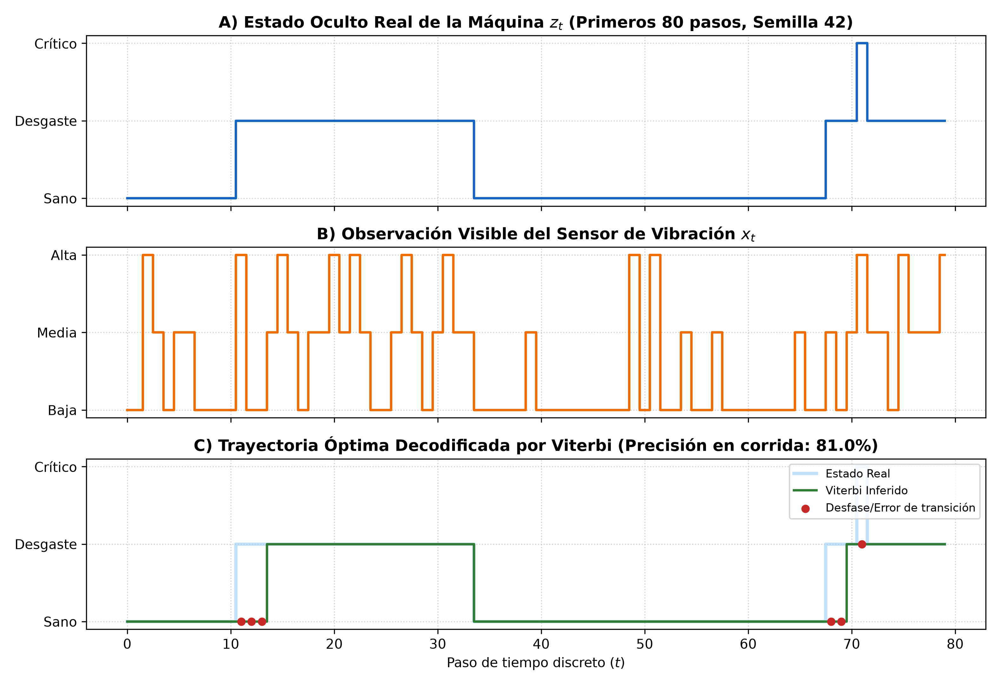
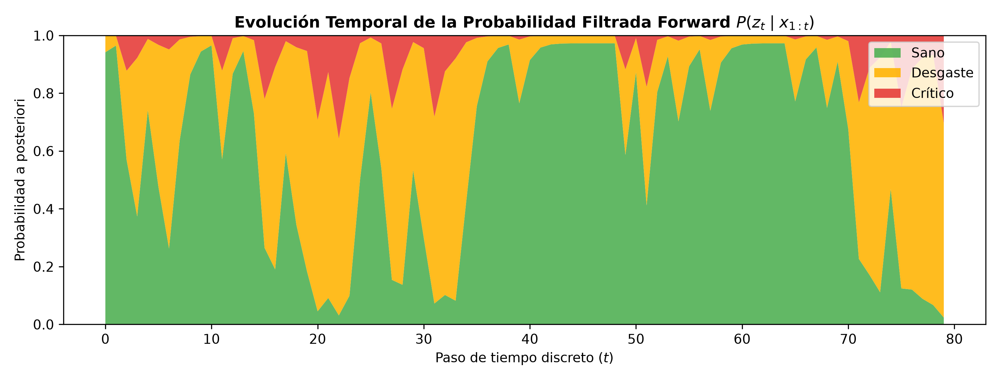
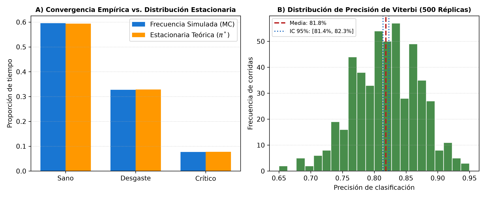
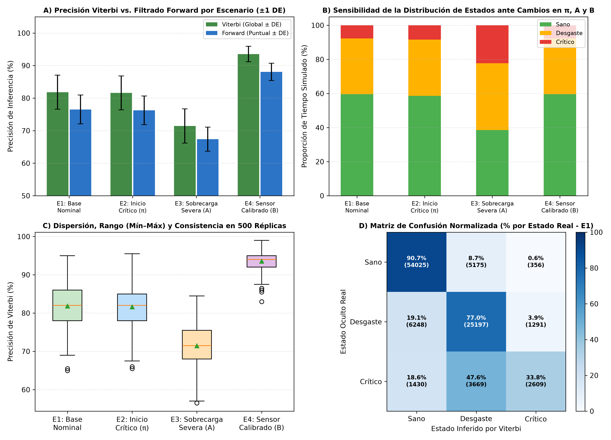

# Simulación de un Modelo Oculto de Markov (HMM) para el Monitoreo del Estado de una Máquina Industrial a partir de su Vibración

**Institución Universitaria Digital de Antioquia (IU Digital)**  
**Asignatura:** Simulación (`PREICA2602B020045`) – Ingeniería de Software y Datos  
**Docente:** Dr. Julián Andrés Loaiza López  
**Integrante:** Raul Santiago Morales Henao (`shenao356`) · **Grupos de trabajo 3**

[](https://colab.research.google.com/drive/1-vbgSLRVWTWi4QncF219L3HfnanEuLb6?usp=sharing)

---

## 1. Planteamiento del Problema
Una máquina industrial rotativa (motor de inducción o bomba centrífuga) evoluciona entre **estados internos ocultos de degradación** $S = \{\text{Sano}, \text{Desgaste}, \text{Crítico}\}$ que no pueden observarse directamente sin detener la operación y desarmar el activo. Lo único medible en línea mediante sensores acelerométricos es el **nivel discreto de vibración** $V = \{\text{Vibración Baja}, \text{Vibración Media}, \text{Vibración Alta}\}$.

El Modelo Oculto de Markov discreto $\lambda = (S, V, A, B, \pi)$ modela este proceso estocástico doblemente embebido y permite inferir la condición interna mediante:
1. **Filtrado Forward Escalado** (evaluación causal en línea y log-verosimilitud exacta).
2. **Decodificación Global de Viterbi** en espacio logarítmico (reconstrucción de la trayectoria óptima).
3. **Aprendizaje No Supervisado de Baum-Welch (EM)** (estimación de matrices a partir de lecturas de vibración sin etiquetas).

---

## 2. Documentación de Mejoras Implementadas Respecto al Primer Código Base
Tomando como punto de partida una versión preliminar del simulador, se implementaron **cinco mejoras estructurales y estadísticas bajo estándar Q1**:

1. **Ampliación de 1 escenario fijo a 4 escenarios experimentales dinámicos (`ESCENARIOS` y `evaluar_escenario`):** Se parametrizaron las funciones `simular()`, `forward()`, `viterbi()` y `estacionaria()` para evaluar sensibilidad frente a cambios en $\pi$ (E2), sobrecarga operativa en $A$ (E3) y calibración del sensor en $B$ (E4), pasando de $100{,}000$ a **$400{,}000$ pasos simulados** ($4 \times 500 \times 200$).
2. **Estadística inferencial completa con Intervalos de Confianza al 95% (`estadisticos_ic95`):** Cálculo de media ($\bar{X}$), desviación estándar insesgada ($s$), mínimo, máximo e **$\text{IC}_{95\%} = \bar{X} \pm 1.96 \cdot (s/\sqrt{500})$** tanto para Viterbi como para el filtrado Forward, exportados en [`comparacion_escenarios.csv`](comparacion_escenarios.csv).
3. **Matriz de Confusión $3 \times 3$ y Retardo de Detección (`calcular_retardo_deteccion`):** Desglose de sensibilidad (*Recall*) por estado (`Sano`, `Desgaste`, `Crítico`) y cuantificación exacta del número de pasos que tarda Viterbi en detectar la entrada a un nuevo episodio de falla.
4. **Algoritmo Backward Escalado y Aprendizaje No Supervisado de Baum-Welch (`backward` y `baum_welch`):** Implementación desde cero del tercer problema de Rabiner (Expectation-Maximization) sobre 40 secuencias de observación, convergiendo en 35 iteraciones y recuperando la matriz $B$ con un error máximo de $0.0580$.
5. **Visualizaciones científicas a 300 DPI y Cuaderno Google Colab 100% Autocontenido:** Generación de 5 figuras a 300 DPI y construcción del notebook [`Morales_Henao_Santiago_Grupo3_HMM.ipynb`](Morales_Henao_Santiago_Grupo3_HMM.ipynb) ejecutable de principio a fin en Google Colab sin archivos externos.

---

## 3. Parámetros del Escenario Base ($E_1$)
Probabilidades iniciales ($\pi$): `Sano = 0.80` · `Desgaste = 0.18` · `Crítico = 0.02`

| Estado Oculto | → Sano ($A$) | → Desgaste ($A$) | → Crítico ($A$) | Vib. Baja ($B$) | Vib. Media ($B$) | Vib. Alta ($B$) |
|---|---:|---:|---:|---:|---:|---:|
| **Sano ($S_0$)** | 0.92 | 0.07 | 0.01 | 0.75 | 0.20 | 0.05 |
| **Desgaste ($S_1$)** | 0.05 | 0.85 | 0.10 | 0.20 | 0.55 | 0.25 |
| **Crítico ($S_2$)** | 0.40 | 0.10 | 0.50 | 0.05 | 0.25 | 0.70 |

---

## 4. Resultados Estadísticos Multi-Escenario (500 réplicas × 200 pasos, `seed = 42`)

| Escenario Experimental | Precisión Viterbi Media ± DE | Rango Viterbi [Mín, Máx] | IC 95% Viterbi | Precisión Forward Media ± DE | Tiempo en Crítico / Recall Crítico |
|---|---:|---:|---:|---:|---:|
| **E1: Base (Nominal)** | **81.83% ± 5.22%** | [65.00%, 95.00%] | **[81.37%, 82.29%]** | 76.52% ± 4.45% | 7.71% / Recall: 33.85% |
| **E2: Inicio Crítico ($\pi$)** | **81.62% ± 5.19%** | [65.50%, 95.50%] | **[81.16%, 82.07%]** | 76.24% ± 4.41% | 8.42% / Recall: 37.33% |
| **E3: Sobrecarga ($A$)** | **71.45% ± 5.27%** | [56.50%, 84.50%] | **[70.99%, 71.91%]** | 67.41% ± 3.71% | 22.21% / Recall: 46.35% |
| **E4: Sensor Calibrado ($B$)** | **93.55% ± 2.38%** | [83.00%, 99.00%] | **[93.34%, 93.76%]** | 88.09% ± 2.66% | 7.70% / Recall: 73.77% |

---

## 5. Evidencia Gráfica Generada (300 DPI)

### Figura 1. Topología del HMM y Flujo Metodológico (F1–F7)


### Figura 2. Simulación Individual y Decodificación de Viterbi (`seed = 42`, Precisión 81.0%)


### Figura 3. Evolución Temporal de la Probabilidad Filtrada Forward $P(z_t \mid x_{0:t})$


### Figura 4. Convergencia Estacionaria Ergódica e Histograma Monte Carlo con IC 95%


### Figura 5. Comparación Multi-Escenario (E1–E4), Boxplots y Matriz de Confusión


---

## 6. Estructura del Repositorio e Instrucciones de Ejecución

* [`Morales_Henao_Santiago_Grupo3_HMM.ipynb`](Morales_Henao_Santiago_Grupo3_HMM.ipynb): Cuaderno interactivo principal 100% autocontenido sincronizado con [Google Colab](https://colab.research.google.com/drive/1-vbgSLRVWTWi4QncF219L3HfnanEuLb6?usp=sharing).
* [`hmm_simulacion.py`](hmm_simulacion.py): Script completo de simulación, inferencia (Forward, Viterbi, Baum-Welch), evaluación Monte Carlo y generación gráfica a 300 DPI.
* [`comparacion_escenarios.csv`](comparacion_escenarios.csv), [`resumen_montecarlo.csv`](resumen_montecarlo.csv), [`secuencia_simulada.csv`](secuencia_simulada.csv), [`salida_consola.txt`](salida_consola.txt): Datos tabulares y salida de consola exportados.

### Opción 1: Ejecutar en Google Colab (Recomendado)
Haz clic en el botón **Open in Colab** en la parte superior de este README (o abre directamente [https://colab.research.google.com/drive/1-vbgSLRVWTWi4QncF219L3HfnanEuLb6?usp=sharing](https://colab.research.google.com/drive/1-vbgSLRVWTWi4QncF219L3HfnanEuLb6?usp=sharing)) y selecciona `Entorno de ejecución -> Ejecutar todo`.

### Opción 2: Ejecución Local en Python
```bash
pip install -r requirements.txt
python hmm_simulacion.py --pasos 200 --semilla 42 --corridas 500
```
